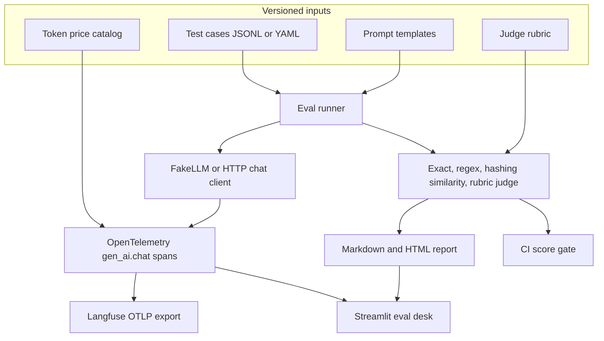

# llm-eval-observability

Regression evals and OpenTelemetry tracing for LLM prompts. Version a prompt, run it over a checked-in dataset, score the outputs, and fail CI if a score drops.

[](https://github.com/applycoding/llm-eval-observability/actions/workflows/ci.yml)

## Honest demo note

This is a portfolio demo. The default model is `FakeLLM`, a deterministic heuristic with no network call and no weights. Embedding similarity is local token hashing, not a hosted embedding model. The sample report and `baselines/support_v2.json` are whatever that fake produced on the checked-in dataset. They are regenerated by `python scripts/refresh_artifacts.py` and a test fails if the files drift. They are not a published benchmark, and this repo does not claim a score for any production model.

Token cost is read from `pricing/catalog.yaml`. The fake model is priced at zero. A model that is not in the catalog is reported as unknown cost. The toolkit does not invent a price. `HttpChatLLM` can call an OpenAI-compatible chat endpoint, and it records only usage the server returns.

Langfuse export is optional. It is an OTLP/HTTP exporter aimed at the project's public traces endpoint, and it is attached only when `LANGFUSE_PUBLIC_KEY` and `LANGFUSE_SECRET_KEY` are set. See the [Langfuse OpenTelemetry docs](https://langfuse.com/docs/opentelemetry/get-started).

## Architecture



The runner renders one prompt version, calls the client once per case, then runs every scorer that applies to that case. Exact and regex apply only when the case has `expected` or `expected_regex`. The judge always runs and opens its own span. Means ignore skipped scorers. A client error scores applicable scorers as zero so the gate can see the failure.

## Quick start

```bash
python -m pip install -e ".[dev,dashboard]"
python -m llm_eval_obs eval --version 1 --out runs/v1.json
python -m llm_eval_obs eval --version 2 --out runs/v2.json
python -m llm_eval_obs report --before runs/v1.json --after runs/v2.json --format md
python -m llm_eval_obs gate --tolerance 0 --no-langfuse
streamlit run src/llm_eval_obs/dashboard/app.py
```

`runs/` is gitignored. The gate reruns prompt version 2 with the fake model and compares scorer means to `baselines/support_v2.json`. A drop larger than `--tolerance` exits 1. CI runs the same command.

To point spans at Langfuse, set the project keys and omit `--no-langfuse`:

```bash
export LANGFUSE_PUBLIC_KEY="pk-..."
export LANGFUSE_SECRET_KEY="sk-..."
export LANGFUSE_HOST="https://cloud.langfuse.com"   # or your region / self-hosted host
python -m llm_eval_obs eval --version 2 --out runs/v2.json
```

The exporter posts OTLP/HTTP to `{LANGFUSE_HOST}/api/public/otel/v1/traces` with Basic auth and `x-langfuse-ingestion-version: 4`.

## What is in the repo

| Path | Role |
| --- | --- |
| `prompts/support/` | Prompt `support` versions 1 and 2. Version 2 receives the policy. |
| `datasets/support.jsonl` | Canonical cases. `datasets/support.yaml` is the same cases in YAML. |
| `rubrics/support_quality.yaml` | Faithfulness and helpfulness, scale 1 to 5. |
| `suites/support.yaml` | Scorers, dataset, model name, price catalog. |
| `pricing/catalog.yaml` | Per-million token rates. Only `fake-llm` is listed, at zero. |
| `baselines/support_v2.json` | Frozen fake-model means for the gate. |
| `reports/support_v1_vs_v2.md` and `.html` | Sample comparison of prompt versions 1 and 2. |
| `src/llm_eval_obs/` | Library, CLI, and Streamlit app. |
| `.github/workflows/ci.yml` | Ruff, compile, pytest, and the score gate. |

The support cases are short policy questions: a return window, a late shipment, a password reset the policy does not cover, a damaged item, and one reply with an exact expected string. They are fixtures for the toolkit, not a customer-support benchmark.

## Scorers

- **exact** compares collapsed whitespace, case-insensitive unless `casefold: false`.
- **regex** uses `re.search`. Patterns that do not compile fail the run.
- **embedding** hashes tokens with SHA-256 into 64 signed buckets and reports cosine similarity clamped to `[0, 1]`. The threshold is a pass/fail mark. The gate tracks the continuous similarity.
- **llm_judge** asks the same client for JSON scores on the rubric, normalizes the scale to `[0, 1]`, and weights the criteria. `FakeLLM` fills those scores from lexical overlap with the reference so the path runs offline. A real client is used unchanged: the parser accepts a JSON object, including one wrapped in a fence.

## Tracing

Each model call is a `gen_ai.chat` span with `gen_ai.request.model`, `gen_ai.usage.input_tokens`, `gen_ai.usage.output_tokens`, plus latency, cost, prompt id, prompt version, case id, and role (`task` or `judge`). Prompt and completion text are clipped at 2000 characters.

## Dashboard

The Streamlit app runs the fake model from the repo root, or loads a JSON run from `eval`. It shows scorer means, per-case rows, a two-version delta, and the spans captured in that session. Download buttons write the same Markdown and HTML the CLI writes.

## Development

```bash
ruff check src tests
ruff format --check src tests
pytest
python -m llm_eval_obs gate --tolerance 0 --no-langfuse
```

After a deliberate prompt or scorer change, refresh the frozen files and review the diff. Do not type scores in by hand.

```bash
python scripts/refresh_artifacts.py
```

GitHub Actions is the test run for this repo. It installs the package, lints, compiles, runs pytest, and runs the gate. Tests use the fake client and never need an API key or a model download.
